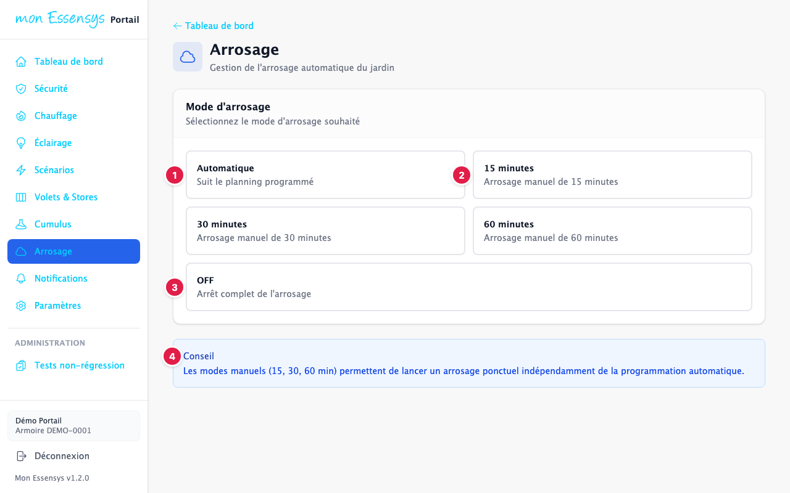
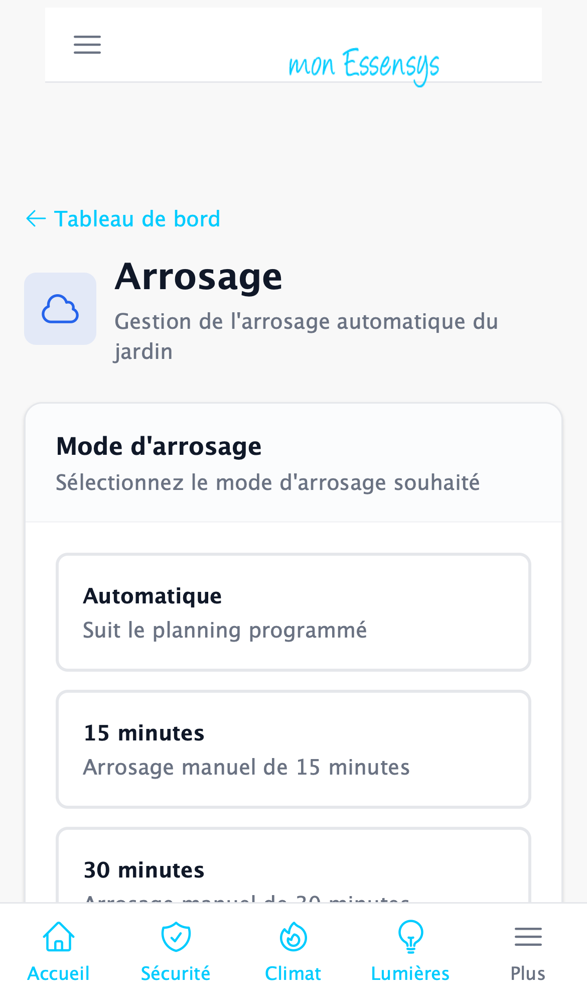

# Arrosage

> Cet écran évolue : son apparence peut changer légèrement d'une version à l'autre.

## À quoi sert cet écran

Gérer l'arrosage automatique du jardin, ou lancer un arrosage ponctuel.

## Y accéder

Menu **Arrosage** (ordinateur), menu **Plus** (téléphone), ou la carte **Arrosage** du tableau de bord.

## L'écran en détail

1. **Automatique** : l'arrosage suit le planning programmé dans l'armoire.
2. **15 minutes**, **30 minutes**, **60 minutes** : lancent un arrosage manuel de cette durée, en plus du planning.
3. **OFF** : arrêt complet de l'arrosage.
4. **Conseil** : les modes manuels permettent un arrosage ponctuel sans changer la programmation.

## Messages courants

| Message | Que faire |
|---|---|
| Commande envoyée | L'armoire lance ou arrête l'arrosage en quelques secondes. |

## Un problème ?

Utilisez **[Signaler un problème](https://www.essensys.fr/signaler)**.
