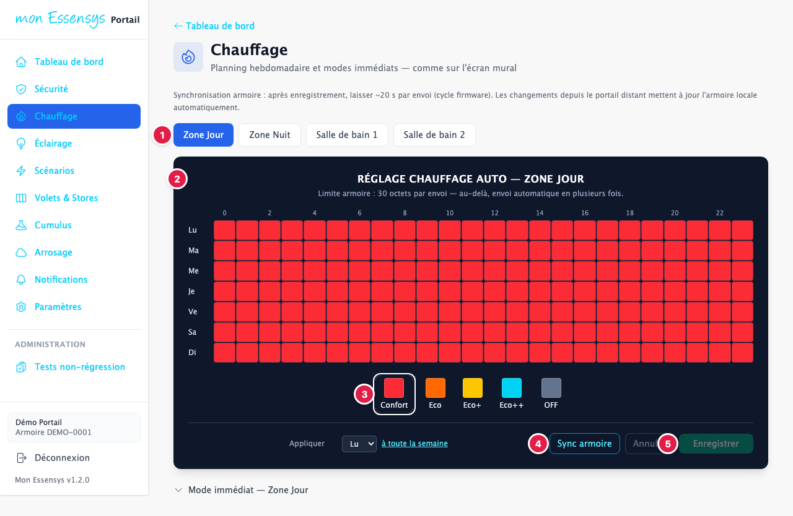
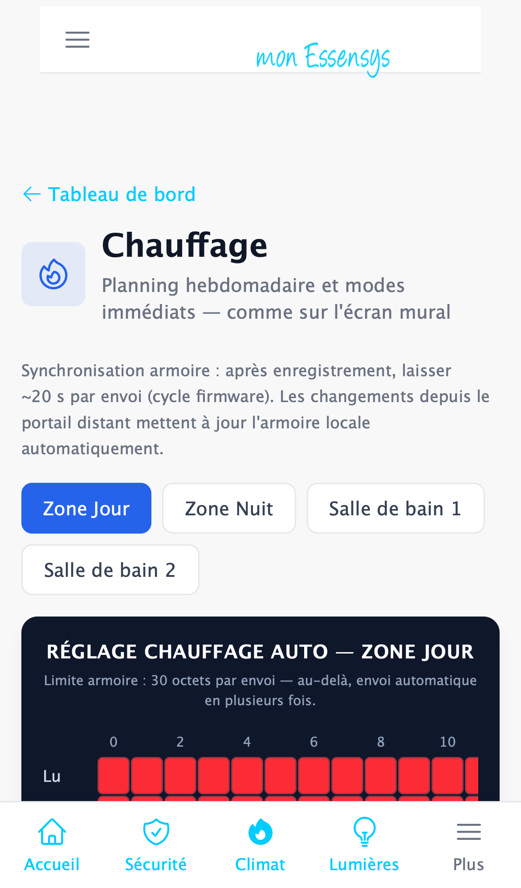

# Chauffage

> Cet écran évolue : son apparence peut changer légèrement d'une version à l'autre.

## À quoi sert cet écran

Régler le planning de chauffage de la semaine, zone par zone, comme sur l'écran mural de votre armoire, et choisir un mode immédiat.

## Y accéder

Menu **Chauffage** (ordinateur), **Climat** en bas de l'écran (téléphone), ou la carte **Chauffage** du tableau de bord.

## L'écran en détail

1. **Les zones** : Zone Jour, Zone Nuit, Salle de bain 1, Salle de bain 2. Choisissez la zone à régler.
2. **Le planning de la semaine** de la zone choisie : une ligne par jour (Lu à Di), une case par tranche horaire de 0 h à 24 h. La couleur de chaque case indique le mode prévu.
3. **Les modes** : **Confort**, **Eco**, **Eco+**, **Eco++** (de plus en plus économe) et **OFF**. Choisissez un mode dans cette légende, puis **touchez ou faites glisser** votre doigt (ou la souris) sur les cases du planning pour les « peindre » dans ce mode. Juste en dessous, **Appliquer [jour] à toute la semaine** recopie le planning d'un jour sur tous les autres.
4. **Sync armoire** : relit le planning enregistré dans l'armoire.
5. **Enregistrer** : envoie le planning à l'armoire. **Annuler** abandonne vos modifications.

Plus bas, **Mode immédiat** force un mode tout de suite pour la zone, sans changer le planning.

> **Bon à savoir** : après **Enregistrer**, l'armoire met environ **20 secondes** à prendre en compte chaque envoi. Un planning complet peut être envoyé en plusieurs fois : c'est automatique.

## Messages courants

| Message | Que faire |
|---|---|
| Envoi en plusieurs fois | Normal pour un planning chargé : attendez la fin de l'envoi. |
| Le planning affiché ne correspond pas à l'armoire | Appuyez sur **Sync armoire** pour relire le planning réel. |

## Un problème ?

Utilisez **[Signaler un problème](https://www.essensys.fr/signaler)** en précisant la zone concernée.
