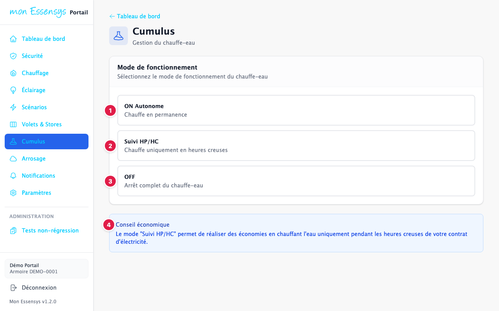
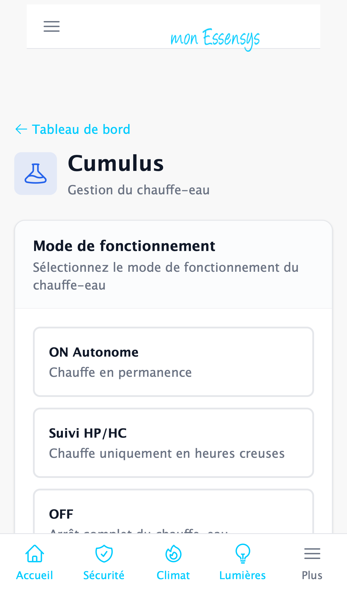

# Chauffe-eau

> Cet écran évolue : son apparence peut changer légèrement d'une version à l'autre.

## À quoi sert cet écran

Choisir le mode de fonctionnement du chauffe-eau (cumulus).

## Y accéder

Menu **Cumulus** (ordinateur), menu **Plus** (téléphone), ou la carte **Cumulus** du tableau de bord.

## L'écran en détail

1. **ON Autonome** : le chauffe-eau chauffe en permanence.
2. **Suivi HP/HC** : il chauffe uniquement pendant les **heures creuses** de votre contrat d'électricité.
3. **OFF** : arrêt complet du chauffe-eau (pratique en cas d'absence prolongée).
4. **Conseil économique** : le mode « Suivi HP/HC » est le plus économique si vous avez un contrat heures pleines / heures creuses.

Appuyez sur un mode pour l'envoyer à l'armoire.

## Messages courants

| Message | Que faire |
|---|---|
| Commande envoyée | Le mode est pris en compte par l'armoire en quelques secondes. |

## Un problème ?

Utilisez **[Signaler un problème](https://www.essensys.fr/signaler)**.
