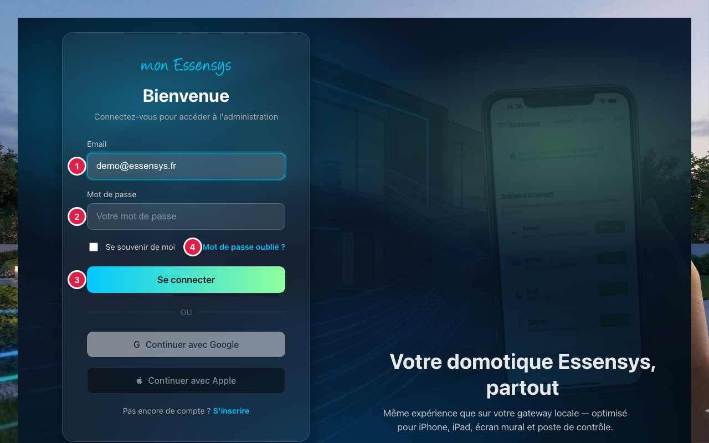
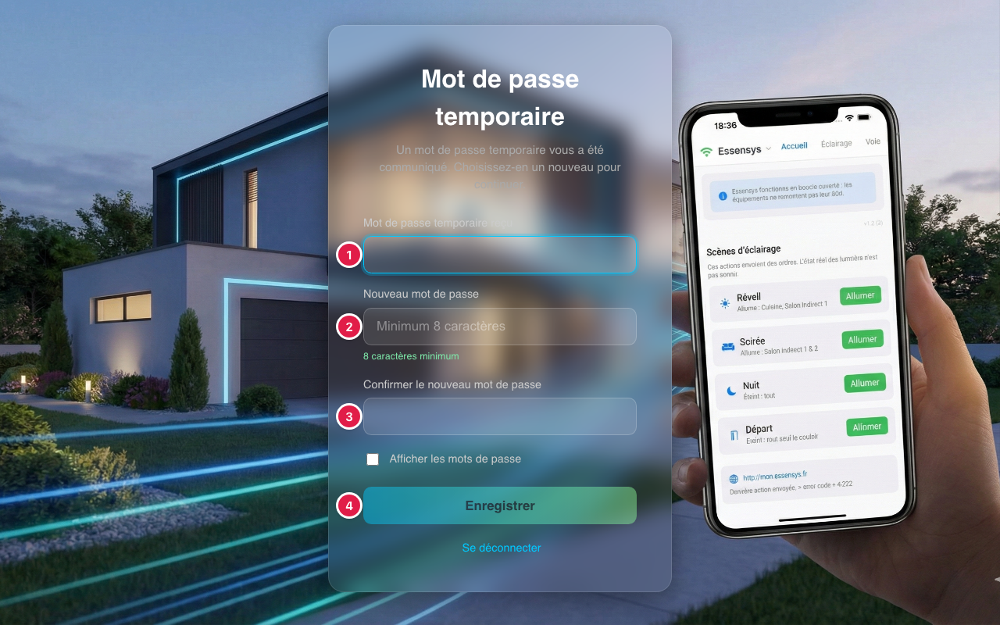

# Connexion et mots de passe

## À quoi sert cet écran

Il vous permet d'accéder à votre compte Essensys, de retrouver un mot de passe oublié et de remplacer un mot de passe temporaire.

## Y accéder

Sur **www.essensys.fr**, appuyez sur **Log in** en haut de la page, ou ouvrez directement www.essensys.fr/login.

## L'écran en détail

1. **Email** : l'adresse de votre compte Essensys.
2. **Mot de passe** : votre mot de passe.
3. **Se connecter** : ouvre votre espace. Si vous veniez d'une page réservée aux comptes connectés (le guide, par exemple), vous y revenez automatiquement.
4. **Mot de passe oublié ?** : vous recevez un email avec un lien de réinitialisation, valable pendant une durée limitée et utilisable **une seule fois**.

### Mot de passe temporaire

Si l'équipe Essensys vous a remis un mot de passe temporaire, le site vous demande d'en choisir un nouveau dès la connexion.

1. **Mot de passe temporaire reçu** : celui que l'équipe Essensys vous a remis.
2. **Nouveau mot de passe** : au moins 8 caractères, différent du mot de passe temporaire.
3. **Confirmer le nouveau mot de passe** : le même nouveau mot de passe.
4. **Enregistrer** : enregistre le nouveau mot de passe et ouvre votre espace.

Tant que ce changement n'est pas fait, les autres pages restent inaccessibles.

## Messages courants

| Message | Que faire |
|---|---|
| Identifiants incorrects | Vérifiez l'email et le mot de passe, en respectant les majuscules. |
| Mot de passe temporaire expiré | Il n'est valable que quelques jours. Demandez-en un nouveau à l'équipe Essensys, ou utilisez **Mot de passe oublié ?** |
| Lien de réinitialisation invalide | Le lien a déjà servi ou il a expiré. Refaites une demande. |

## Un problème ?

Utilisez **[Signaler un problème](https://www.essensys.fr/signaler)** une fois connecté, ou écrivez à support@essensys.fr si vous ne pouvez pas vous connecter.
