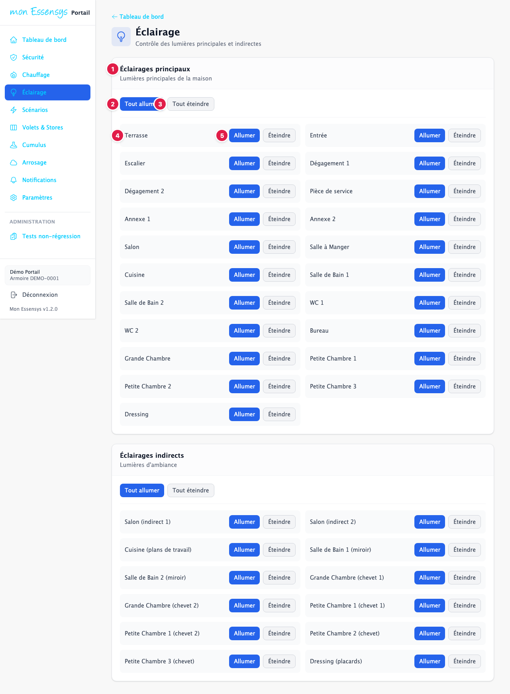
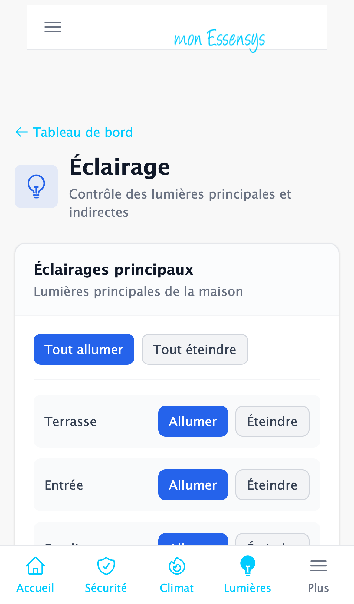

# Éclairage

## À quoi sert cet écran

Allumer et éteindre les lumières de la maison, pièce par pièce ou toutes ensemble.

## Y accéder

Menu **Éclairage** (ordinateur), **Lumières** en bas de l'écran (téléphone), ou la carte **Éclairage** du tableau de bord.

## L'écran en détail

1. **Éclairages principaux** : les plafonniers et appliques de chaque pièce. Plus bas sur la page, **Éclairages indirects** regroupe les éclairages d'ambiance, avec les mêmes boutons.
2. **Tout allumer** : allume tous les éclairages du groupe.
3. **Tout éteindre** : éteint tous les éclairages du groupe.
4. **Le nom de la pièce** (Terrasse, Entrée, Salon…), tel qu'il est configuré dans votre armoire.
5. **Allumer** / **Éteindre** : commande la lumière de cette pièce.

Après chaque appui, le portail confirme l'envoi. L'armoire exécute la commande en **quelques secondes**. N'appuyez pas plusieurs fois de suite : la commande est déjà partie.

## Messages courants

| Message | Que faire |
|---|---|
| Commande envoyée | Tout va bien : l'armoire exécute la commande. |
| Boutons grisés | La passerelle est hors ligne : voir le [tableau de bord](tableau-de-bord.md). |
| Erreur d'envoi | Réessayez dans un instant. Si l'erreur persiste, faites un signalement. |

## Un problème ?

Une lumière ne réagit pas alors que la commande est envoyée ? Utilisez **[Signaler un problème](https://www.essensys.fr/signaler)** en précisant la pièce.
