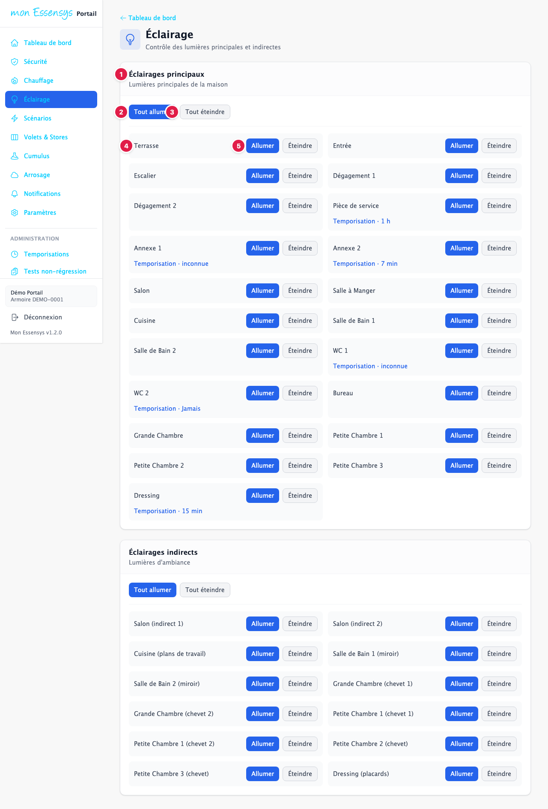
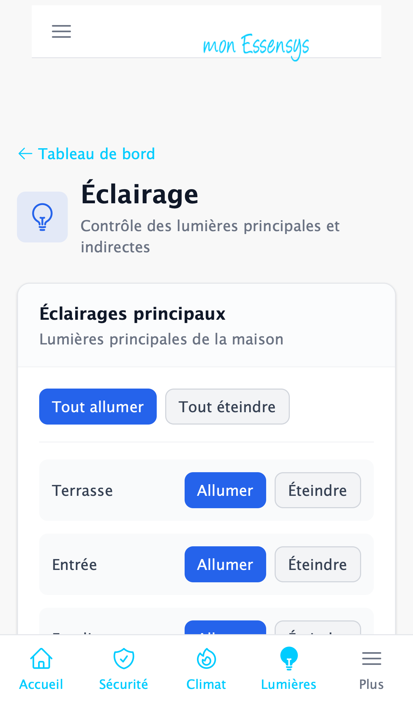

# Éclairage

## À quoi sert cet écran

Allumer et éteindre les lumières de la maison, pièce par pièce ou toutes ensemble.

## Y accéder

Menu **Éclairage** (ordinateur), **Lumières** en bas de l'écran (téléphone), ou la carte **Éclairage** du tableau de bord.

## L'écran en détail

1. **Éclairages principaux** : les plafonniers et appliques de chaque pièce. Plus bas sur la page, **Éclairages indirects** regroupe les éclairages d'ambiance, avec les mêmes boutons.
2. **Tout allumer** : allume tous les éclairages du groupe.
3. **Tout éteindre** : éteint tous les éclairages du groupe.
4. **Le nom de la pièce** (Terrasse, Entrée, Salon…), tel qu'il est configuré dans votre armoire.
5. **Allumer** / **Éteindre** : commande la lumière de cette pièce.

Si vous êtes **administrateur de l'armoire**, les lumières du Dressing, des WC 1 et 2, du Service et des Annexes 1 et 2 proposent en plus le lien **Temporisation** : il déplie le réglage de leur extinction automatique (voir **[Temporisations](temporisations.md)**).

Le nom affiché est celui de votre installation : si l'administrateur a renommé une lumière (par exemple « Dressing » devenu « WC 3 »), c'est ce nom qui apparaît ici, dans l'écran **[Temporisations](temporisations.md)** et dans les messages de confirmation. L'**administrateur de l'armoire** voit sous chaque lumière le lien **Renommer** : il déplie le champ **Nom** (1 à 40 caractères, sans « < » ni « > »). **Enregistrer** applique le nom ; **Nom d'origine** rétablit le nom fourni avec l'armoire. Renommer une lumière ne change rien dans l'armoire.

L'**administrateur de l'armoire** voit aussi, en haut de l'écran, le lien **Gérer l'affichage**. Il ouvre la liste de toutes les lumières, y compris celles qui sont désactivées : l'interrupteur **Activé / Désactivé** masque ou rétablit une lumière, **Monter** et **Descendre** la déplacent dans son groupe (principal ou indirect), **Ordre d'origine** remet l'ordre fourni avec l'armoire et réactive tout. Rien ne change tant que vous n'avez pas appuyé sur **Enregistrer** (une seule écriture). Une lumière désactivée disparaît pour tout le monde : de la liste, de **Tout allumer** / **Tout éteindre** et de l'écran **[Temporisations](temporisations.md)**. Si toutes les lumières d'un groupe sont désactivées, le groupe affiche « Aucune lumière activée ». Les scénarios gardent la liste complète, et le réglage ne change rien dans l'armoire.

Après chaque appui, le portail confirme l'envoi. L'armoire exécute la commande en **quelques secondes**. N'appuyez pas plusieurs fois de suite : la commande est déjà partie.

## Messages courants

| Message | Que faire |
|---|---|
| Nom enregistré : WC 3 | Le nouveau nom s'affiche désormais partout. |
| Le nom ne doit pas dépasser 40 caractères | Raccourcissez le nom. |
| Renommer une lumière est réservé à l'administrateur de l'armoire | Demandez à l'administrateur de votre installation. |
| Les noms sont momentanément indisponibles | Réessayez plus tard ; les noms d'origine restent affichés. |
| Disposition enregistrée | Les lumières désactivées sont masquées et l'ordre choisi s'applique partout. |
| Modifier l'affichage des lumières est réservé à l'administrateur de l'armoire | Demandez à l'administrateur de votre installation. |
| L'affichage est momentanément indisponible | Réessayez plus tard ; vos modifications restent à l'écran. |
| Commande envoyée | Tout va bien : l'armoire exécute la commande. |
| Boutons grisés | La passerelle est hors ligne : voir le [tableau de bord](tableau-de-bord.md). |
| Erreur d'envoi | Réessayez dans un instant. Si l'erreur persiste, faites un signalement. |

## Un problème ?

Une lumière ne réagit pas alors que la commande est envoyée ? Utilisez **[Signaler un problème](https://www.essensys.fr/signaler)** en précisant la pièce.
