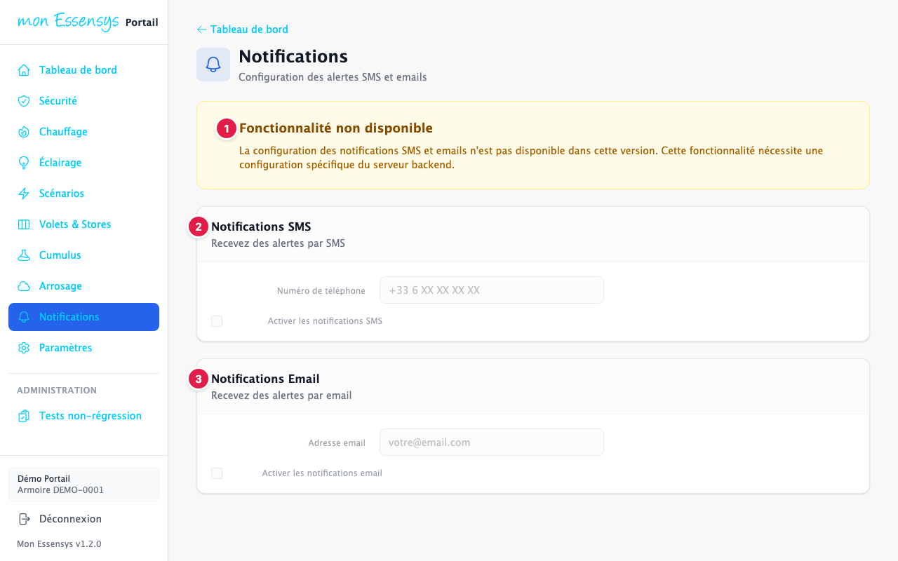
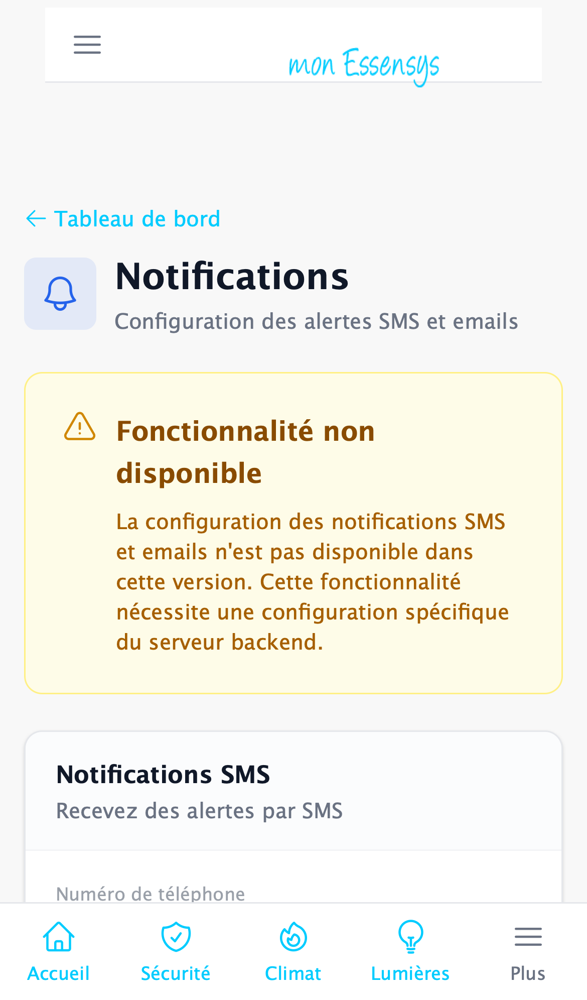

# Notifications

> Cette fonction n'est **pas encore disponible**. L'écran montre ce qu'elle proposera.

## À quoi sert cet écran

Recevoir des alertes de votre installation par SMS ou par email.

## Y accéder

Menu **Notifications** (ordinateur), menu **Plus** (téléphone), ou la carte **Notifications** du tableau de bord.

## L'écran en détail

1. **Fonctionnalité non disponible** : la configuration des alertes demande une évolution du serveur Essensys, prévue dans une prochaine version.
2. **Notifications SMS** : le numéro de téléphone qui recevra les alertes.
3. **Notifications Email** : l'adresse qui recevra les alertes.

Tant que la fonction n'est pas disponible, les champs ne sont pas enregistrés.

## Un problème ?

Vous souhaitez une alerte en particulier ? Dites-le-nous avec **[Signaler un problème](https://www.essensys.fr/signaler)** (type « Bug logiciel ») : vos besoins aideront à construire cette fonction.
