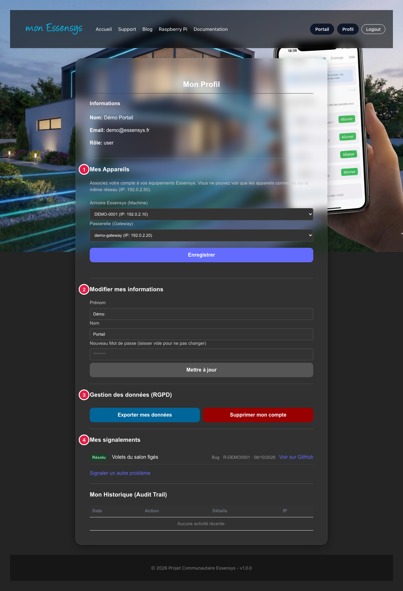
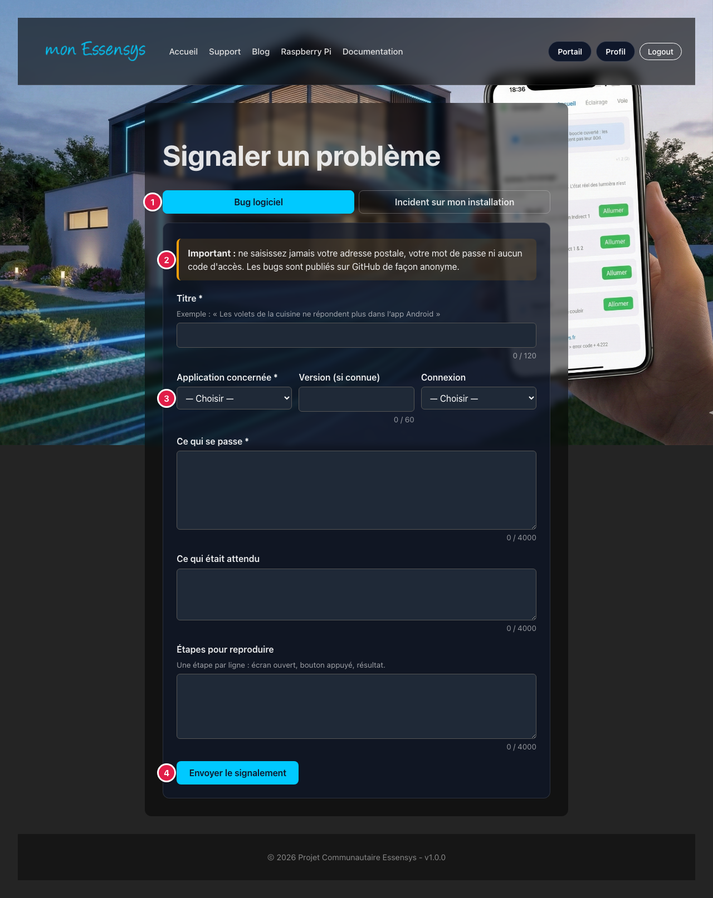

# Profil et signalements

## À quoi sert cet écran

Votre **profil**, sur www.essensys.fr, regroupe vos informations, la liaison de votre armoire, vos signalements et vos données personnelles. Le formulaire **Signaler un problème** vous permet de déclarer un bug ou un incident sans compte GitHub.

## Y accéder

Sur **www.essensys.fr**, une fois connecté, appuyez sur **Profil** en haut de la page.

## Le profil en détail

1. **Mes appareils** : liez votre compte à votre **armoire** et à votre **passerelle**. Seuls les appareils de votre réseau sont proposés : faites cette étape **chez vous, sur votre Wi-Fi**. Appuyez ensuite sur **Enregistrer**.
2. **Modifier mes informations** : prénom, nom et mot de passe.
3. **Mes signalements** : l'état de vos signalements (en attente d'envoi, ouvert, résolu, clos).
4. **Gestion des données (RGPD)** : exporter vos données ou supprimer votre compte.

## Signaler un problème

1. **Le type** : **Bug logiciel** (un écran ou une commande qui ne fonctionne pas) ou **Incident sur mon installation** (une panne chez vous).
2. **L'avertissement** : ne saisissez jamais votre adresse postale, votre mot de passe ni aucun code d'accès. Les bugs sont publiés sur GitHub de façon **anonyme**.
3. **Les informations demandées** : l'application concernée, ce qui se passe, ce qui était attendu.
4. **Envoyer le signalement** : vous recevez une référence (« R-… »). Vous suivez ensuite son état dans **Mes signalements**.

Chaque signalement est relu par l'équipe Essensys avant d'être traité. Vous pouvez en envoyer jusqu'à 5 par jour.

## Messages courants

| Message | Que faire |
|---|---|
| « Ce texte semble contenir un mot de passe / une adresse postale » | Retirez l'information concernée : elle n'est pas utile pour traiter le problème. |
| Limite de signalements atteinte | Vous avez déjà envoyé 5 signalements en 24 heures : réessayez à l'heure indiquée. |
| Aucun appareil proposé dans Mes appareils | Vous n'êtes pas sur le réseau de votre installation : réessayez depuis chez vous, sur votre Wi-Fi. |
