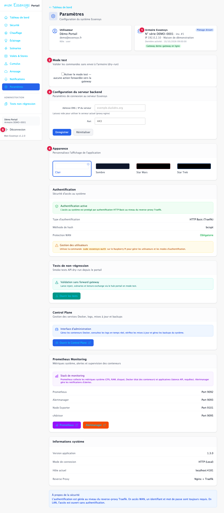
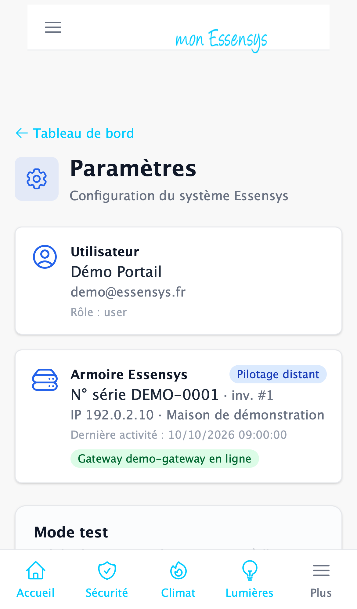

# Réglages

## À quoi sert cet écran

Voir les informations de votre compte et de votre installation, activer le mode test et choisir l'apparence du portail.

## Y accéder

Menu **Paramètres** (ordinateur), menu **Plus** (téléphone), ou la carte **Paramètres** du tableau de bord.

## L'écran en détail

1. **Utilisateur** et **Armoire Essensys** : votre compte, le numéro de série de votre armoire et l'état de la passerelle.
2. **Mode test** : quand il est activé, le portail **vérifie** vos commandes sans les envoyer à l'armoire. Rien ne bouge à la maison : c'est utile pour découvrir le portail sans risque. Pensez à le désactiver ensuite.
3. **Configuration du serveur backend** : réservé à l'installateur. Laissez ces champs vides.
4. **Apparence** : **Clair**, **Sombre**, et deux thèmes pour s'amuser (**Star Wars**, **Star Trek**). Le choix est mémorisé sur cet appareil.
5. **Déconnexion** : ferme votre session sur cet appareil. Sur téléphone, ce bouton se trouve dans le menu **Plus**.

Plus bas, les sections **Authentification**, **Tests de non-régression**, **Control Plane**, **Prometheus Monitoring** et **Informations système** concernent la passerelle locale et l'équipe technique. Vous n'avez pas à les utiliser.

## Messages courants

| Message | Que faire |
|---|---|
| Une bannière « mode test » s'affiche sur les écrans | Le mode test est actif : vos commandes ne partent pas. Désactivez-le ici. |

## Un problème ?

Utilisez **[Signaler un problème](https://www.essensys.fr/signaler)**.
