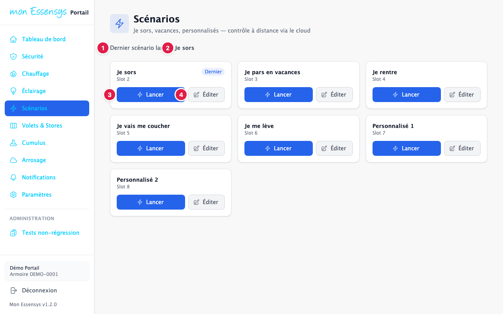
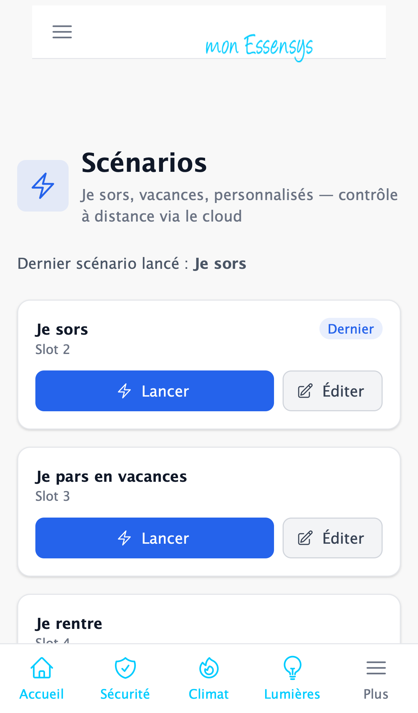

# Scénarios

## À quoi sert cet écran

Lancer en un geste un ensemble de commandes préparées dans votre armoire : « Je sors », « Je pars en vacances », « Je rentre », « Je vais me coucher », « Je me lève », ou vos scénarios personnalisés.

## Y accéder

Menu **Scénarios** (ordinateur) ou menu **Plus** (téléphone).

## L'écran en détail

1. **Dernier scénario lancé** : le dernier scénario envoyé à l'armoire.
2. **La carte du scénario** : son nom et son emplacement dans l'armoire (« Slot »). Le badge « Dernier » repère le dernier lancé.
3. **Lancer** : exécute le scénario tout de suite.
4. **Éditer** : ouvre un panneau qui détaille ce que fait le scénario (lumières, volets, chauffage…). Vous pouvez y modifier les réglages puis **Enregistrer**, le **Lancer**, revenir au réglage d'usine avec **Défaut firmware**, ou **Fermer** sans rien changer. Le choix **Prises de sécurité** (ne rien faire, couper, rétablir) permet par exemple à « Je sors » de couper les prises de sécurité.

> **Bon à savoir** : un scénario agit sur plusieurs équipements à la fois. Avant de le lancer à distance, vérifiez que personne n'est gêné à la maison (volets qui se ferment, chauffage qui baisse…).

## Messages courants

| Message | Que faire |
|---|---|
| Échec lancement | Vérifiez que la passerelle est en ligne sur le [tableau de bord](tableau-de-bord.md), puis réessayez. |
| Preset firmware demandé | Le scénario revient à son réglage d'usine : il est rechargé dans le panneau. |

## Un problème ?

Utilisez **[Signaler un problème](https://www.essensys.fr/signaler)** en précisant le nom du scénario.
