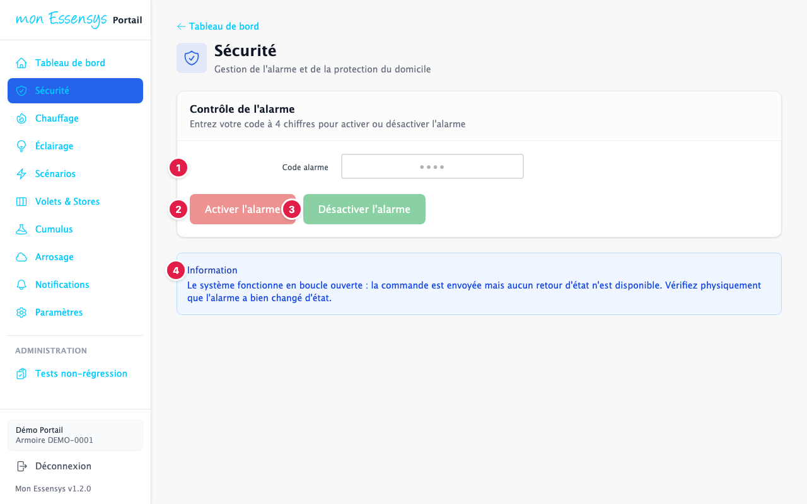
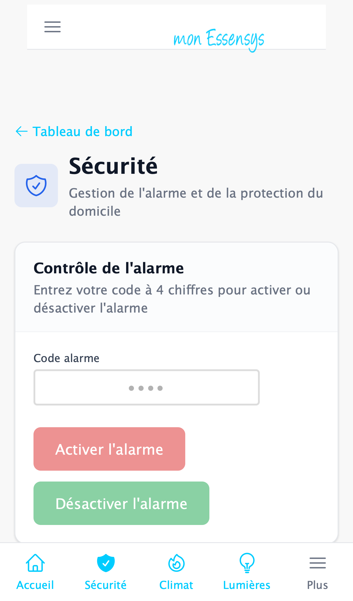

# Sécurité

> Cet écran évolue : son apparence peut changer légèrement d'une version à l'autre.

## À quoi sert cet écran

Activer et désactiver l'alarme de la maison à distance, avec votre code.

## Y accéder

Menu **Sécurité** (ordinateur), **Sécurité** en bas de l'écran (téléphone), ou la carte **Sécurité** du tableau de bord.

## L'écran en détail

1. **Code alarme** : saisissez votre code à **4 chiffres**, le même que sur le clavier de l'alarme.
2. **Activer l'alarme** : met l'alarme en service.
3. **Désactiver l'alarme** : coupe l'alarme.
4. **Information** : le système fonctionne en **boucle ouverte**. La commande est envoyée, mais le portail ne reçoit pas de confirmation de l'état de l'alarme.

> **Important** : après une commande d'alarme envoyée à distance, assurez-vous par un autre moyen (voisin, caméra, retour sur place) que l'alarme a bien changé d'état. Ne communiquez jamais votre code, y compris dans un signalement.

## Messages courants

| Message | Que faire |
|---|---|
| Code invalide | Le code doit comporter exactement 4 chiffres. |
| Commande envoyée | La commande est partie ; vérifiez l'état réel de l'alarme. |

## Un problème ?

Utilisez **[Signaler un problème](https://www.essensys.fr/signaler)**, sans jamais indiquer votre code.
