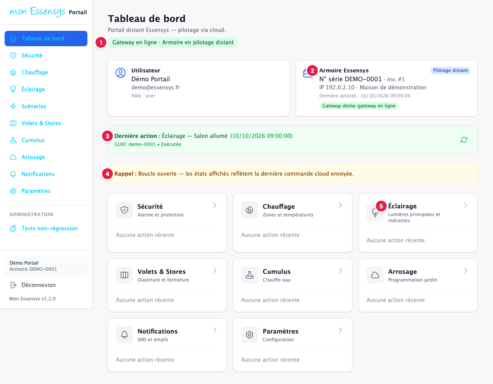
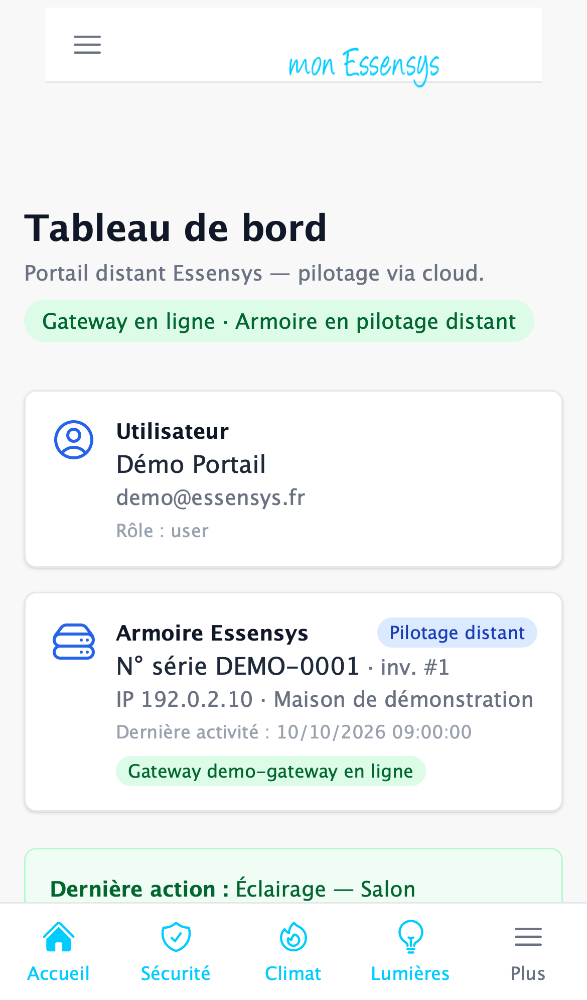
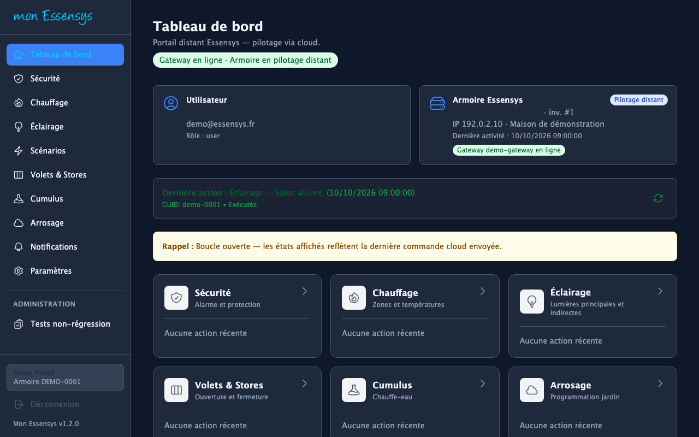

# Tableau de bord

## À quoi sert cet écran

C'est la page d'accueil du portail. Elle montre en un coup d'œil l'état de votre installation et donne accès à toutes les fonctions.

## Y accéder

Il s'ouvre après la connexion. Vous y revenez à tout moment avec **Tableau de bord** dans le menu de gauche (ordinateur) ou **Accueil** en bas de l'écran (téléphone).

## L'écran en détail

1. **État de la connexion** : « Gateway en ligne » signifie que votre installation est joignable. « Armoire en pilotage distant » confirme que les commandes peuvent être envoyées depuis le portail.
2. **Armoire Essensys** : le numéro de série de votre armoire, sa dernière activité et l'état de la passerelle (gateway).
3. **Dernière action** : la dernière commande envoyée, avec sa date et son état (« Exécutée » quand l'armoire l'a traitée). Le bouton circulaire à droite rafraîchit l'affichage.
4. **Rappel « boucle ouverte »** : le portail affiche la dernière commande envoyée, pas forcément l'état réel des équipements.
5. **Accès aux fonctions** : une carte par fonction (Sécurité, Chauffage, Éclairage, Volets et stores, Cumulus, Arrosage, Notifications, Paramètres). Appuyez sur une carte pour l'ouvrir.

Sur téléphone, la barre en bas de l'écran donne accès à **Accueil**, **Sécurité**, **Climat**, **Lumières** et **Plus** (les autres fonctions).

Le portail existe aussi en thème sombre (voir [Réglages](reglages.md)) :

> La rubrique **Administration** du menu (Tests non-régression) est réservée à l'équipe Essensys. Vous n'avez pas à l'utiliser.

## Messages courants

| Message | Que faire |
|---|---|
| Gateway hors ligne | Votre installation n'est pas joignable : vérifiez la box internet et l'alimentation de la passerelle. Les commandes ne partiront pas tant qu'elle est hors ligne. |
| Aucune armoire liée à ce compte | Liez votre armoire depuis votre profil (voir [Premiers pas](premiers-pas.md)). |

## Un problème ?

Utilisez **[Signaler un problème](https://www.essensys.fr/signaler)**.
