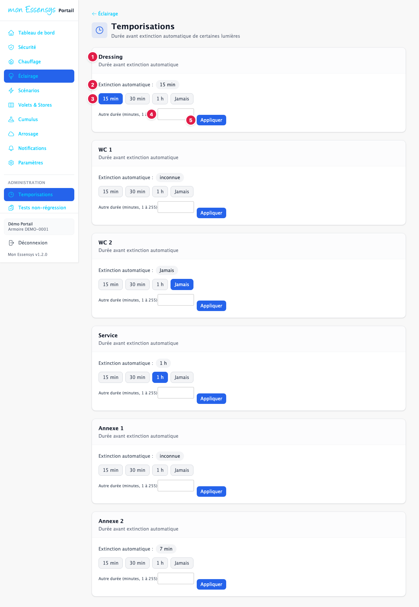
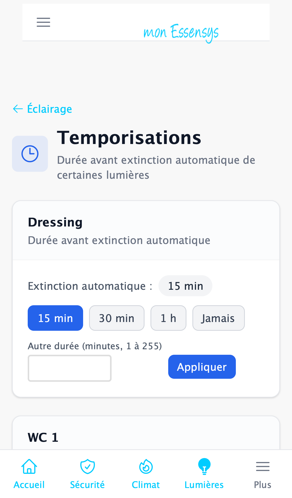

# Temporisations

> Cet écran évolue : son apparence peut changer légèrement d'une version à l'autre.

## À quoi sert cet écran

Six lumières de la maison s'éteignent toutes seules au bout d'un délai : **Dressing**, **WC 1**, **WC 2**, **Service**, **Annexe 1** et **Annexe 2**. Cet écran règle ce délai à distance, sans aller devant l'écran tactile de l'armoire.

## Y accéder

Menu **Temporisations**, dans la section **Administration** (ordinateur) ou dans le menu en haut à gauche (téléphone). Le réglage d'une lumière est aussi dans la page **[Éclairage](eclairage.md)** : cliquez sur **Temporisation** sous le nom de la lumière.

Ce réglage est **réservé à l'administrateur de l'armoire**. Un autre utilisateur ne voit ni le menu ni le lien **Temporisation**.

## L'écran en détail

1. **Le nom de la lumière** : tel qu'il s'affiche dans l'écran **[Éclairage](eclairage.md)** (le nom personnalisé s'il existe, sinon le nom d'origine). Une carte par lumière, dans l'ordre Dressing, WC 1, WC 2, Service, Annexe 1, Annexe 2.
2. **Extinction automatique** : la durée actuellement réglée dans l'armoire, par exemple **7 min**, **1 h** ou **Jamais**. Si l'armoire ne l'a pas encore transmise, le portail affiche **inconnue**.
3. **Les raccourcis** : **15 min**, **30 min**, **1 h** et **Jamais** (la lumière reste allumée jusqu'à ce que vous l'éteigniez).
4. **Autre durée** : une durée libre, **de 1 à 255 minutes**. Pour ne jamais éteindre, utilisez **Jamais** plutôt que 0.
5. **Appliquer** : envoie la durée saisie. Une valeur hors de 1 à 255 est refusée avant l'envoi, avec un message.

Après un envoi, le portail affiche **En attente de l'armoire** et relit la valeur au bout de 5, 10 puis 20 secondes. Il indique quand l'armoire a bien pris en compte la nouvelle durée. Quand l'armoire est hors ligne, tous les boutons sont grisés.

> **À savoir** : l'écran tactile de l'armoire ne propose que 15 min, 30 min, 1 h et Jamais. Il peut ne pas afficher une durée libre comme 7 min.

## Messages courants

| Message | Que faire |
|---|---|
| Dressing : 7 min envoyée | La commande est partie ; l'armoire l'applique sous quelques secondes. |
| Dressing : 7 min confirmée par l'armoire | La durée est bien réglée. |
| l'armoire n'a pas encore confirmé | Attendez un peu puis rechargez la page ; si la valeur reste différente, signalez-le. |
| Validée (test, non exécutée) | Le mode test est actif : rien n'a été envoyé à l'armoire. |
| Armoire hors ligne | Le réglage revient dès que l'armoire est de nouveau joignable. |
| Ce réglage est réservé à l'administrateur de l'armoire | Demandez à l'administrateur de votre installation. |

## Un problème ?

Utilisez **[Signaler un problème](https://www.essensys.fr/signaler)**.
