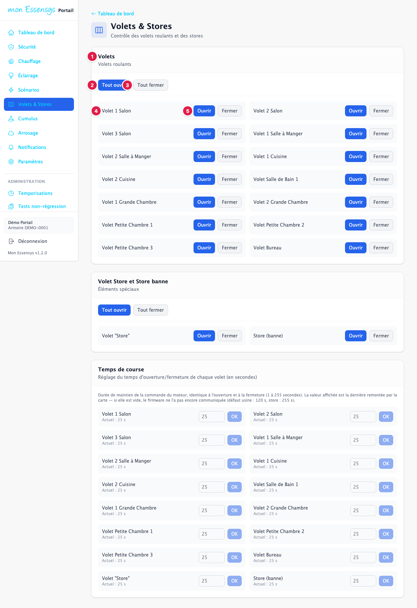
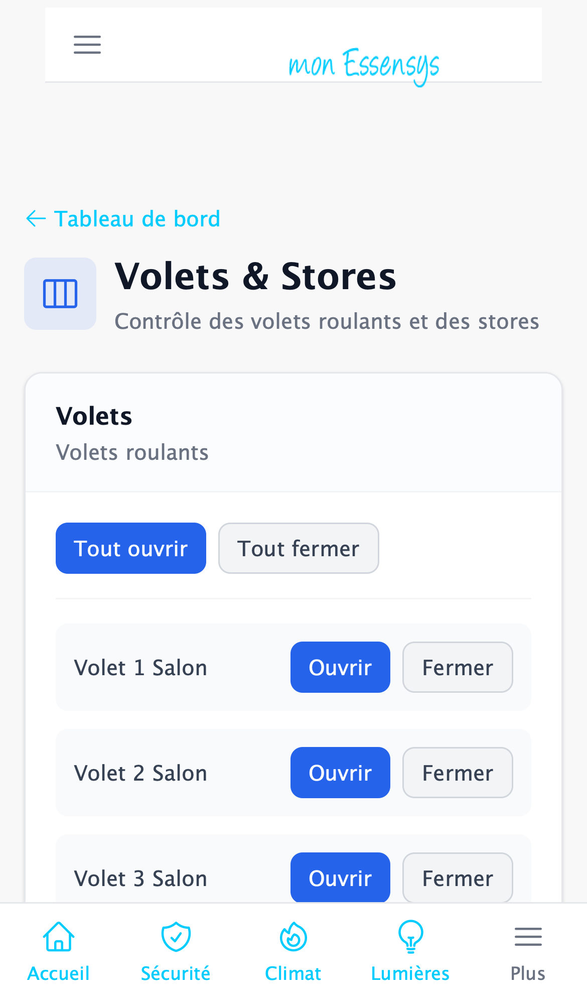

# Volets et stores

## À quoi sert cet écran

Ouvrir et fermer les volets roulants et les stores, un par un ou tous ensemble.

## Y accéder

Menu **Volets & Stores** (ordinateur), menu **Plus** (téléphone), ou la carte **Volets & Stores** du tableau de bord.

## L'écran en détail

1. **Volets** : les volets roulants de la maison. Plus bas, la section **Volet Store et Store banne** fonctionne de la même façon.
2. **Tout ouvrir** : ouvre tous les volets du groupe.
3. **Tout fermer** : ferme tous les volets du groupe.
4. **Le nom du volet** (Volet 1 Salon, Volet Cuisine…), tel qu'il est configuré dans votre installation.
5. **Ouvrir** / **Fermer** : commande ce volet.

Le nom affiché est celui de votre installation : si l'administrateur a renommé un volet (par exemple « Volet 1 Salon » devenu « Volet baie vitrée »), c'est ce nom qui apparaît dans la liste, dans la section **Temps de course** et dans les messages de confirmation. L'**administrateur de l'armoire** voit sous chaque volet le lien **Renommer** : il déplie le champ **Nom** (1 à 40 caractères, sans « < » ni « > »). **Enregistrer** applique le nom ; **Nom d'origine** rétablit le nom fourni avec l'armoire. Renommer un volet ne le fait pas bouger et ne change rien dans l'armoire.

Un volet met un certain **temps de course** pour s'ouvrir ou se fermer complètement (souvent 20 à 30 secondes). Attendez la fin du mouvement avant de renvoyer une commande.

En bas de la page, la section **Temps de course** permet de régler cette durée, en secondes, pour chaque volet : saisissez la valeur puis appuyez sur **OK**. Ne la modifiez que si un volet s'arrête avant d'être complètement ouvert ou fermé.

## Messages courants

| Message | Que faire |
|---|---|
| Commande envoyée | L'armoire exécute la commande ; le volet bouge en quelques secondes. |
| Nom enregistré : Volet baie vitrée | Le nouveau nom s'affiche désormais partout. |
| Le nom ne doit pas dépasser 40 caractères | Raccourcissez le nom. |
| Renommer un volet est réservé à l'administrateur de l'armoire | Demandez à l'administrateur de votre installation. |
| Les noms sont momentanément indisponibles | Réessayez plus tard ; les noms d'origine restent affichés. |
| Boutons grisés | La passerelle est hors ligne : voir le [tableau de bord](tableau-de-bord.md). |

## Un problème ?

Un volet reste immobile ? Vérifiez d'abord qu'il fonctionne avec l'interrupteur mural, puis utilisez **[Signaler un problème](https://www.essensys.fr/signaler)**.
