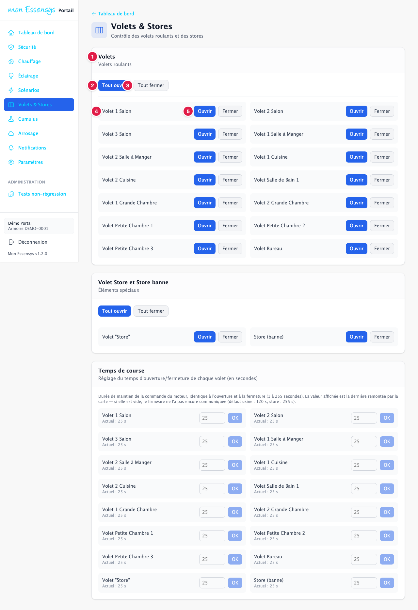
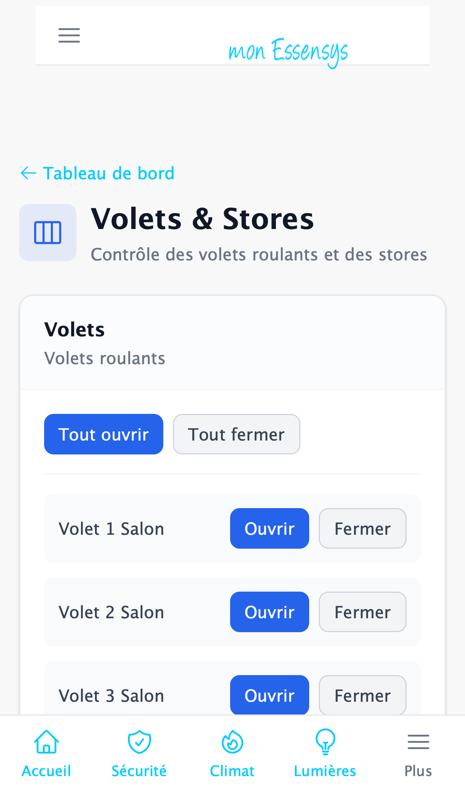

# Volets et stores

## À quoi sert cet écran

Ouvrir et fermer les volets roulants et les stores, un par un ou tous ensemble.

## Y accéder

Menu **Volets & Stores** (ordinateur), menu **Plus** (téléphone), ou la carte **Volets & Stores** du tableau de bord.

## L'écran en détail

1. **Volets** : les volets roulants de la maison. Plus bas, la section **Volet Store et Store banne** fonctionne de la même façon.
2. **Tout ouvrir** : ouvre tous les volets du groupe.
3. **Tout fermer** : ferme tous les volets du groupe.
4. **Le nom du volet** (Volet 1 Salon, Volet Cuisine…), tel qu'il est configuré dans votre armoire.
5. **Ouvrir** / **Fermer** : commande ce volet.

Un volet met un certain **temps de course** pour s'ouvrir ou se fermer complètement (souvent 20 à 30 secondes). Attendez la fin du mouvement avant de renvoyer une commande.

En bas de la page, la section **Temps de course** permet de régler cette durée, en secondes, pour chaque volet : saisissez la valeur puis appuyez sur **OK**. Ne la modifiez que si un volet s'arrête avant d'être complètement ouvert ou fermé.

## Messages courants

| Message | Que faire |
|---|---|
| Commande envoyée | L'armoire exécute la commande ; le volet bouge en quelques secondes. |
| Boutons grisés | La passerelle est hors ligne : voir le [tableau de bord](tableau-de-bord.md). |

## Un problème ?

Un volet reste immobile ? Vérifiez d'abord qu'il fonctionne avec l'interrupteur mural, puis utilisez **[Signaler un problème](https://www.essensys.fr/signaler)**.
